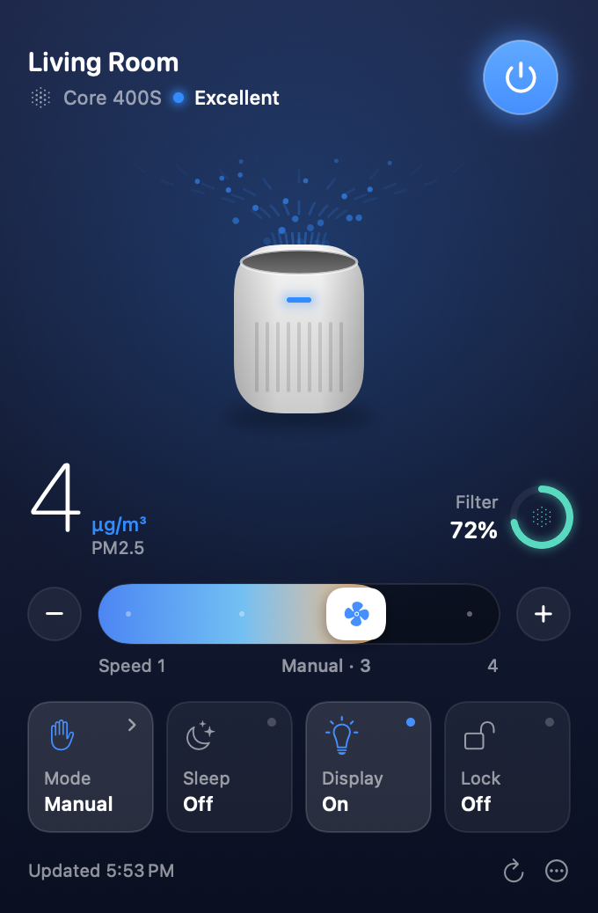

# LevoitBar

A small macOS menu-bar app for controlling Levoit air purifiers through your VeSync account.

<p align="center"></p>

From the menu bar you can turn each purifier on or off, pick the mode (Manual, Auto, Sleep, and Pet or Turbo where the model has them), set the fan speed, and toggle the display and child lock. It also shows air quality, PM2.5 and filter life when the model reports them. Status refreshes every minute and whenever you open the menu.

The menu-bar fan spins while a purifier is running. Next to it, a dot shows the air quality in Levoit's colours: blue for excellent, green for good, orange for moderate and red for poor.

## Supported models

| Model | Status |
| --- | --- |
| Core 200S / 300S / 400S / 600S | Supported |
| Vital 100S / 200S | Supported |
| Everest Air, Sprout Air | Supported |
| LV-H131S (LV-RH131S) | Supported |
| LV-PUR131S | Listed but not controllable (older API) |

## Install

1. Download `LevoitBar.zip` from the [latest release](../../releases/latest) and unzip it.
2. Drag `LevoitBar.app` into your Applications folder.
3. Open it. The app isn't notarised by Apple, so the first time macOS will say it can't verify the developer. Click **Done**, then go to **System Settings › Privacy & Security**, scroll down and click **Open Anyway**. (Or run `xattr -dr com.apple.quarantine /Applications/LevoitBar.app` in Terminal.)
4. A fan icon appears in the menu bar. Click it and sign in with the same email and password as the VeSync phone app.

To start it automatically, add it under **System Settings › General › Login Items**. After that, updates install themselves (see below).

## Build from source

You need macOS 14 or later and Xcode or the Command Line Tools (`xcode-select --install`).

```bash
git clone https://github.com/alexgallacher/LevoitBar.git
cd LevoitBar
./build-app.sh
cp -R build/LevoitBar.app /Applications/
open /Applications/LevoitBar.app
```

For development you can also run `swift run --build-system native`, or open `Package.swift` in Xcode. (`build-app.sh` uses the `native` build system because the default one fails to start on some Command Line Tools-only setups.)

## Updates

LevoitBar keeps itself up to date from this repo's [GitHub Releases](../../releases). It checks shortly after launch and every 6 hours. When a newer version is out, it downloads it, replaces itself and relaunches. You can turn automatic installs off, or check by hand, from the ••• menu at the bottom of the panel (**Check for Updates…** and **Install Updates Automatically**).

To publish a new version, commit your changes and run:

```bash
./release.sh 1.1.0
```

That builds the app with the new version number, tags the commit, and creates a GitHub release with `LevoitBar.zip` attached. Running copies pick it up on their next check. It uses the GitHub CLI (`gh`), which is already signed in on this Mac.

## How it works

The app talks to the same VeSync cloud API the phone app uses (`smartapi.vesync.com`, or `smartapi.vesync.eu` for European accounts; the app follows the server's redirect automatically). The request formats follow the open-source [pyvesync](https://github.com/webdjoe/pyvesync) library. All traffic is HTTPS. The app keeps only an MD5 hash of your password (the form VeSync's login takes) and your session token, both in the macOS Keychain, and sends them only to VeSync. The only other network traffic is the update check against GitHub.

VeSync's API is unofficial and can change. If sign-in or a control stops working, the request shapes live in `Sources/LevoitBar/VeSyncClient.swift` and `Purifier.swift`.

## Files

- `VeSyncClient.swift` — login, device list and device commands
- `Purifier.swift` — per-model capabilities, status parsing and command payloads
- `AppModel.swift` — app state, polling and re-login when the token expires
- `Views.swift` — the menu-bar UI
- `Keychain.swift` — credential storage
- `Updater.swift` — self-update from GitHub Releases
- `Snapshot.swift` — `--snapshot out.png` renders the panel with sample data
